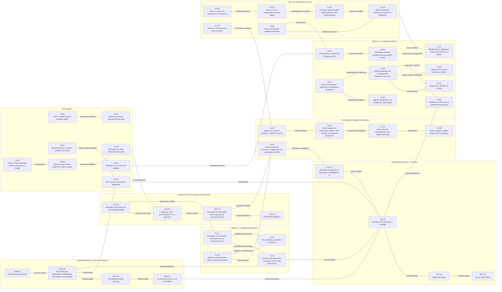

[Início](../README.md) › Relações entre conteúdos

# Relações entre conteúdos

Nenhuma atividade vive sozinha. Aqui mostro como elas se conectam. Cada ligação também aparece na seção **Relacionado com** da página da atividade e no campo `relacionados` dos metadados.

## Mapa

## Tabela de relações

| De | Para | Tipo de relação | Por quê |
|---|---|---|---|
| [IA-03](../5-periodo/eletiva-3-ia/03-sbc-biblioteca/README.md) | [IA-04](../5-periodo/eletiva-3-ia/04-prolog-biblioteca/README.md) | traduzido para | As regras SE…ENTÃO do sistema da biblioteca foram escritas em Prolog. |
| [IA-02](../5-periodo/eletiva-3-ia/02-mundo-do-wumpus/README.md) | [IA-05](../5-periodo/eletiva-3-ia/05-robocode-agente-vigia/README.md) | arquitetura de agente | O Wumpus foi proposto como agente reativo com estado interno, o mesmo tipo do AgenteVigia. |
| [IA-02](../5-periodo/eletiva-3-ia/02-mundo-do-wumpus/README.md) | [IA-03](../5-periodo/eletiva-3-ia/03-sbc-biblioteca/README.md) | conhecimento e inferência | O explorador do Wumpus raciocina sobre uma base de conhecimento, como o sistema da biblioteca. |
| [IA-01](../5-periodo/eletiva-3-ia/01-colonia-de-formigas/README.md) | [IA-06](../5-periodo/eletiva-3-ia/06-estrategias-de-busca/README.md) | busca de soluções | ACO e BFS/DFS procuram soluções em um espaço de possibilidades, de formas diferentes. |
| [IA-06](../5-periodo/eletiva-3-ia/06-estrategias-de-busca/README.md) | [IA-07](../5-periodo/eletiva-3-ia/07-modificando-os-algoritmos/README.md) | comparação de algoritmos | As duas atividades comparam o comportamento de algoritmos ao mudar a estratégia ou os parâmetros. |
| [IA-03](../5-periodo/eletiva-3-ia/03-sbc-biblioteca/README.md) | [IA-08](../5-periodo/eletiva-3-ia/08-logica-fuzzy/README.md) | regras exatas e imprecisas | O sistema da biblioteca usa regras de verdadeiro ou falso, e a lógica fuzzy trabalha com graus de pertinência. |
| [IA-03](../5-periodo/eletiva-3-ia/03-sbc-biblioteca/README.md) | [IA-09](../5-periodo/eletiva-3-ia/09-chatbot-em-python/README.md) | regras SE…ENTÃO | O chatbot também decide a resposta por regras: se a pergunta tem certa palavra, então responde. |
| [EXT-01](../5-periodo/unidade-extensao-full-stack/01-arquitetura-repositorio-e-readme/README.md) | [EXT-02](../5-periodo/unidade-extensao-full-stack/02-imersao-na-problematica-e-prototipo/README.md) | próxima etapa | Depois de definir arquitetura e repositório, veio a imersão na problemática. |
| [EXT-02](../5-periodo/unidade-extensao-full-stack/02-imersao-na-problematica-e-prototipo/README.md) | [EXT-03](../5-periodo/unidade-extensao-full-stack/03-modelo-de-dados/README.md) | próxima etapa | As necessidades levantadas na imersão guiam o modelo de dados. |
| [EXT-03](../5-periodo/unidade-extensao-full-stack/03-modelo-de-dados/README.md) | [EXT-04](../5-periodo/unidade-extensao-full-stack/04-oas-e-crud-base/README.md) | próxima etapa | O modelo de dados é a base da API e do CRUD. |
| [EXT-02](../5-periodo/unidade-extensao-full-stack/02-imersao-na-problematica-e-prototipo/README.md) | [IA-09](../5-periodo/eletiva-3-ia/09-chatbot-em-python/README.md) | mesma plataforma | O chatbot responde perguntas sobre cadastro e matchmaking da plataforma de startups que o projeto propõe. |
| [VV-01](../5-periodo/verificacao-e-validacao-de-software/01-impacto-de-erros-em-projetos/README.md) | [VV-03](../5-periodo/verificacao-e-validacao-de-software/03-testes-manuais-saucedemo/README.md) | custo do defeito | O Ariane 5 mostra o preço de um erro que passa; no SauceDemo barrei um lançamento por causa de um defeito. |
| [VV-03](../5-periodo/verificacao-e-validacao-de-software/03-testes-manuais-saucedemo/README.md) | [VV-04](../5-periodo/verificacao-e-validacao-de-software/04-casos-de-teste-com-katalon/README.md) | manual e automatizado | O mesmo tipo de caso de teste, primeiro executado à mão e depois automatizado por ferramenta. |
| [VV-04](../5-periodo/verificacao-e-validacao-de-software/04-casos-de-teste-com-katalon/README.md) | [VV-05](../5-periodo/verificacao-e-validacao-de-software/05-teste-orientado-a-dados/README.md) | continuação | O teste orientado a dados parte do mesmo fluxo de login do OrangeHRM usado no TC01 e no TC02. |
| [VV-02](../5-periodo/verificacao-e-validacao-de-software/02-levantamento-de-processos-e-maturidade/README.md) | [EXT-01](../5-periodo/unidade-extensao-full-stack/01-arquitetura-repositorio-e-readme/README.md) | processo e arquitetura | As duas tratam de definir e registrar a arquitetura e o processo de um projeto. |
| [GI-01](../5-periodo/eletiva-4-gestao-da-informacao/01-qualidade-da-informacao/README.md) | [GI-02](../5-periodo/eletiva-4-gestao-da-informacao/02-inventario-e-ciclo-de-vida-da-informacao/README.md) | qualidade da informação | A teoria de informação boa ou ruim foi aplicada na matriz de qualidade do RecInTech. |
| [GI-02](../5-periodo/eletiva-4-gestao-da-informacao/02-inventario-e-ciclo-de-vida-da-informacao/README.md) | [EXT-02](../5-periodo/unidade-extensao-full-stack/02-imersao-na-problematica-e-prototipo/README.md) | mesmo projeto | As duas analisam a problemática do RecInTech, uma pelo lado da informação e outra pelo lado do produto. |
| [GI-03](../5-periodo/eletiva-4-gestao-da-informacao/03-mapa-de-conhecimentos-e-licoes-aprendidas/README.md) | [VV-02](../5-periodo/verificacao-e-validacao-de-software/02-levantamento-de-processos-e-maturidade/README.md) | mesmo projeto | As duas olham para o SIGO: uma mapeia o conhecimento crítico e a outra diagnostica a maturidade do processo. |
| [GI-03](../5-periodo/eletiva-4-gestao-da-informacao/03-mapa-de-conhecimentos-e-licoes-aprendidas/README.md) | [GI-04](../5-periodo/eletiva-4-gestao-da-informacao/04-repositorio-academico-no-github/README.md) | registrar o conhecimento | O repositório é onde o conhecimento do mapa fica registrado e compartilhado. |
| [GI-01](../5-periodo/eletiva-4-gestao-da-informacao/01-qualidade-da-informacao/README.md) | [GI-04](../5-periodo/eletiva-4-gestao-da-informacao/04-repositorio-academico-no-github/README.md) | informação organizada | A arquitetura da informação do repositório resolve, na prática, os problemas que a atividade de qualidade aponta. |
| [GOV-01](../5-periodo/governanca-em-ti/01-infografico-governanca-na-transformacao-digital/README.md) | [GOV-02](../5-periodo/governanca-em-ti/02-estudo-de-caso-microsoft/README.md) | conceito e caso real | Os pilares do infográfico aparecem na prática na análise da Microsoft. |
| [GOV-02](../5-periodo/governanca-em-ti/02-estudo-de-caso-microsoft/README.md) | [GOV-03](../5-periodo/governanca-em-ti/03-simulacao-de-requisicoes-no-planner/README.md) | teoria e prática | O alinhamento estratégico estudado na Microsoft é o que cada requisição do Planner precisava justificar. |
| [GOV-03](../5-periodo/governanca-em-ti/03-simulacao-de-requisicoes-no-planner/README.md) | [GOV-04](../5-periodo/governanca-em-ti/04-portfolio-unidade-i/README.md) | registro da prática | O portfólio reflete sobre a simulação do Planner e sobre o que ela ensinou. |
| [GOV-01](../5-periodo/governanca-em-ti/01-infografico-governanca-na-transformacao-digital/README.md) | [GI-01](../5-periodo/eletiva-4-gestao-da-informacao/01-qualidade-da-informacao/README.md) | dados sob controle | Privacidade e segurança da informação aparecem nas duas, uma pelo lado da governança e outra pelo da qualidade. |
| [GOV-03](../5-periodo/governanca-em-ti/03-simulacao-de-requisicoes-no-planner/README.md) | [VV-02](../5-periodo/verificacao-e-validacao-de-software/02-levantamento-de-processos-e-maturidade/README.md) | processo e papéis | As duas tratam de papéis definidos e registro do histórico como base de um processo organizado. |
| [HT-01](../5-periodo/high-tech-aplicada-ao-mercado/01-sensor-de-temperatura-no-tinkercad/README.md) | [HT-02](../5-periodo/high-tech-aplicada-ao-mercado/02-iot-e-computacao-de-borda/README.md) | mesma sequência | O sensor simulado gera o dado que a prática de edge computing processa. |
| [HT-02](../5-periodo/high-tech-aplicada-ao-mercado/02-iot-e-computacao-de-borda/README.md) | [HT-04](../5-periodo/high-tech-aplicada-ao-mercado/04-ml-quest/README.md) | aprendizado de máquina | O TinyML da prática de borda usa o aprendizado supervisionado que o ML Quest cobra. |
| [HT-04](../5-periodo/high-tech-aplicada-ao-mercado/04-ml-quest/README.md) | [HT-06](../5-periodo/high-tech-aplicada-ao-mercado/06-mapa-de-machine-learning/README.md) | mesmo conteúdo | O mapa de machine learning organiza os tipos e algoritmos que o quiz pergunta. |
| [HT-05](../5-periodo/high-tech-aplicada-ao-mercado/05-mapa-interativo-de-ia/README.md) | [HT-06](../5-periodo/high-tech-aplicada-ao-mercado/06-mapa-de-machine-learning/README.md) | materiais de estudo | Os dois mapas se complementam: um abre a área toda de IA, o outro aprofunda machine learning. |
| [HT-05](../5-periodo/high-tech-aplicada-ao-mercado/05-mapa-interativo-de-ia/README.md) | [IA-01](../5-periodo/eletiva-3-ia/01-colonia-de-formigas/README.md) | mesma área | O mapa de IA organiza os campos que as atividades da Eletiva III exploram um a um. |
| [HT-06](../5-periodo/high-tech-aplicada-ao-mercado/06-mapa-de-machine-learning/README.md) | [IA-07](../5-periodo/eletiva-3-ia/07-modificando-os-algoritmos/README.md) | teoria e prática | O mapa explica árvore de decisão e K-Means; a atividade da Eletiva III testa os dois numa base real. |
| [HT-03](../5-periodo/high-tech-aplicada-ao-mercado/03-blockchain-da-teoria-a-pratica/README.md) | [VV-01](../5-periodo/verificacao-e-validacao-de-software/01-impacto-de-erros-em-projetos/README.md) | confiança no sistema | Blockchain protege a integridade do dado; o caso Ariane 5 mostra o custo de confiar num sistema que falha. |
| [TE-01](../5-periodo/tech-english/01-unit-20-present-perfect-x-past/README.md) | [TE-02](../5-periodo/tech-english/02-shale-gas/README.md) | gramática na leitura | A gramática da Unit 20 aparece aplicada nos textos técnicos. |
| [TE-04](../5-periodo/tech-english/04-entrepreneurship/README.md) | [TE-05](../5-periodo/tech-english/05-startup-pitch-matchup/README.md) | mesma ideia de startup | As duas atividades propõem uma plataforma que conecta startups e investidores. |
| [TE-05](../5-periodo/tech-english/05-startup-pitch-matchup/README.md) | [EXT-02](../5-periodo/unidade-extensao-full-stack/02-imersao-na-problematica-e-prototipo/README.md) | mesma ideia | O pitch do MatchUp é a mesma proposta que o Projeto Integrador desenvolveu como RecInTech. |
| [TE-07](../5-periodo/tech-english/07-perguntas-para-recrutadores-do-google/README.md) | [TE-08](../5-periodo/tech-english/08-critical-review-job-at-google/README.md) | mesmo tema | As perguntas foram elaboradas a partir do processo seletivo analisado na resenha. |
| [TE-08](../5-periodo/tech-english/08-critical-review-job-at-google/README.md) | [TE-09](../5-periodo/tech-english/09-technology-careers-microsoft/README.md) | processos seletivos | Google e Microsoft, os dois processos seletivos estudados na matéria. |
| [TE-06](../5-periodo/tech-english/06-glossario-ia-e-trabalho/README.md) | [IA-01](../5-periodo/eletiva-3-ia/01-colonia-de-formigas/README.md) | vocabulário da área | O glossário traz em inglês os termos de IA que as atividades da Eletiva III estudam. |
| [TE-09](../5-periodo/tech-english/09-technology-careers-microsoft/README.md) | [GOV-02](../5-periodo/governanca-em-ti/02-estudo-de-caso-microsoft/README.md) | mesma empresa | As duas analisam a Microsoft, uma pelas carreiras e outra pela governança de TI. |
| [EMP-01](../5-periodo/empreendedorismo-e-plano-de-negocios/01-estudo-de-caso-hotmart/README.md) | [EMP-02](../5-periodo/empreendedorismo-e-plano-de-negocios/02-da-tendencia-a-oportunidade/README.md) | do caso à ideia | O estudo de uma startup real vem antes de analisar a oportunidade do próprio projeto. |
| [EMP-02](../5-periodo/empreendedorismo-e-plano-de-negocios/02-da-tendencia-a-oportunidade/README.md) | [EMP-03](../5-periodo/empreendedorismo-e-plano-de-negocios/03-design-thinking/README.md) | próxima etapa | Identificada a oportunidade, o design thinking trabalha a solução. |
| [EMP-03](../5-periodo/empreendedorismo-e-plano-de-negocios/03-design-thinking/README.md) | [EMP-04](../5-periodo/empreendedorismo-e-plano-de-negocios/04-customer-discovery-e-job-to-be-done/README.md) | próxima etapa | Depois de idear, o customer discovery valida a dor com o público real. |
| [EMP-02](../5-periodo/empreendedorismo-e-plano-de-negocios/02-da-tendencia-a-oportunidade/README.md) | [TE-05](../5-periodo/tech-english/05-startup-pitch-matchup/README.md) | mesma ideia | O MatchMaker desta análise é a mesma plataforma do pitch da MatchUp, feito em inglês. |
| [EMP-04](../5-periodo/empreendedorismo-e-plano-de-negocios/04-customer-discovery-e-job-to-be-done/README.md) | [EXT-02](../5-periodo/unidade-extensao-full-stack/02-imersao-na-problematica-e-prototipo/README.md) | mesma descoberta | As duas ouvem o público do RecInTech antes de construir: uma por formulário, a outra por imersão na problemática. |
| [EMP-02](../5-periodo/empreendedorismo-e-plano-de-negocios/02-da-tendencia-a-oportunidade/README.md) | [GI-02](../5-periodo/eletiva-4-gestao-da-informacao/02-inventario-e-ciclo-de-vida-da-informacao/README.md) | mesma plataforma | A oportunidade analisada aqui é a que o diagnóstico informacional do RecInTech fundamenta com dados. |

## Como leio as relações

- **traduzido para:** o mesmo conteúdo escrito de outra forma (regras em texto e depois em Prolog).
- **arquitetura de agente / conhecimento e inferência / regras SE…ENTÃO:** o mesmo conceito aparece nas duas atividades.
- **busca de soluções / comparação de algoritmos:** assuntos vizinhos que ajudam a entender um ao outro.
- **regras exatas e imprecisas:** conceitos que se contrastam.
